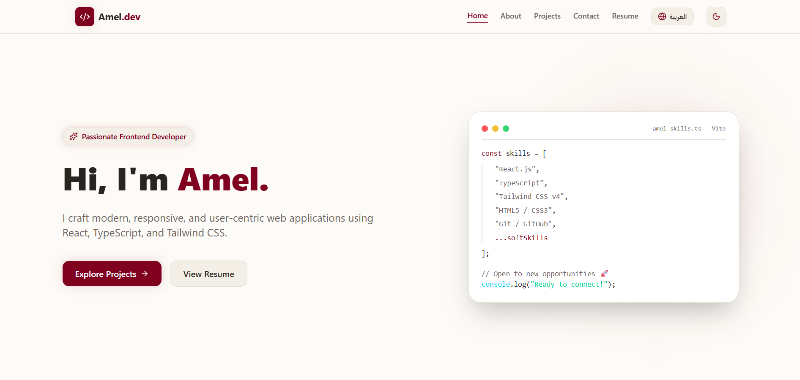

# 🚀 Amel.dev | Personal Portfolio

![Amel.dev Preview] 

A modern, responsive, and performance-optimized personal portfolio showcasing my journey, skills, and featured projects as a Frontend Developer. 

🔗 **Live Website:** [amel-dev-portfolio.vercel.app](https://amel-dev-portfolio.vercel.app)

---

## ✨ Features

- **Interactive UI/UX:** Built with smooth motion effects using **Framer Motion** and interactive mouse tracking elements.
- **Dynamic Theme Toggling:** Seamless switching between Light and Dark modes with custom CSS variables and persistent states.
- **Bilingual Support:** Fully equipped for Arabic and English interfaces.
- **Responsive Design:** Optimized layout ensuring an exceptional experience across mobile devices, tablets, and desktops.
- **Direct CV Access & PDF Integration:** Quick viewing and downloading capabilities for professional resumes.

---

## 🛠️ Tech Stack

This project is crafted with modern web technologies:

- **Core:** [React](https://react.dev/), [TypeScript](https://www.typescriptlang.org/)
- **Build Tool:** [Vite](https://vitejs.dev/)
- **Styling:** [Tailwind CSS v4](https://tailwindcss.com/)
- **Animations:** [Framer Motion](https://www.framer.com/motion/)
- **Icons & UI Utilities:** [Lucide React](https://lucide.dev/), `react-router-dom`
- **Deployment:** [Vercel](https://vercel.com/)

---

## 📂 Project Structure

```tree
src/
├── components/     # Reusable UI components (Navbar, Hero, Projects, Contact, etc.)
├── hooks/          # Custom React hooks (Theme management, etc.)
├── data/           # Structured project and skill data
├── App.tsx         # Main application component & routes
└── main.tsx        # Application entry point
public/             # Static assets (CV PDFs, project showcase images)